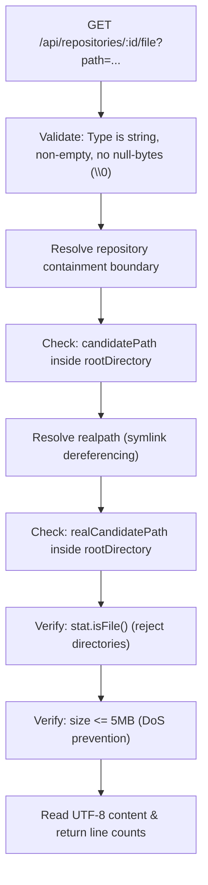

# RepoGraph Code Atlas — Final QA Evidence Review

**Review Date:** October 27, 2026  
**Repository Working Directory:** `D:\New folder (2)\RepoGraph`  
**Current Branch:** `main`  
**Remote Push Status:** Strictly prohibited (held locally on `main`)  
**Overall Verdict:** **SAFE TO COMMIT LOCALLY**

---

## 1. Verified Git State & Commit Contents

### 1.1 Git Status & Branch Output
```bash
$ git status --short --branch
## main...origin/main [ahead 2]
 M apps/web/src/App.css
 M services/api/src/routes/repositories.ts
?? qa-artifacts/
```

### 1.2 Recent Git Commit Log
```bash
$ git log -5 --oneline
e979623 fix(ui): refine Code Atlas responsive layouts, panel toggles, card nodes, and endpoint security tests
11a2757 feat(web): transform UI into RepoGraph The Code Atlas with modular architecture and file preview
166369d fix(hardening): complete final production-readiness security, deterministic config validation, and synthetic benchmark scaling
0703934 fix(security): restrict workspace containment to canonical roots, enforce production config validation, and enhance benchmark methodology
0d50819 feat(audit): implement production readiness refactoring, security boundaries, and benchmark suite
```

### 1.3 Breakdown of Commit `11a2757` (Code Atlas UI Transformation)
Commit [`11a2757`](file:///d:/New%20folder%20(2)/RepoGraph) transformed the application into "RepoGraph: The Code Atlas":
- **Total Changes:** 20 files changed (+5,345 additions, -1,283 deletions).
- **Core Components Introduced:**
  - [`TopBar.tsx`](file:///d:/New%20folder%20(2)/RepoGraph/apps/web/src/components/layout/TopBar.tsx): Brand header, repository selector, ⌘K search, API connection status.
  - [`RepositoryExplorer.tsx`](file:///d:/New%20folder%20(2)/RepoGraph/apps/web/src/components/explorer/RepositoryExplorer.tsx) & [`FileTree.tsx`](file:///d:/New%20folder%20(2)/RepoGraph/apps/web/src/components/explorer/FileTree.tsx): Collapsible file tree with language badges and test-file toggles.
  - [`DependencyAtlas.tsx`](file:///d:/New%20folder%20(2)/RepoGraph/apps/web/src/components/graph/DependencyAtlas.tsx): Cytoscape graph canvas with Dagre, Concentric, and CoSE layouts.
  - [`InspectorPanel.tsx`](file:///d:/New%20folder%20(2)/RepoGraph/apps/web/src/components/inspector/InspectorPanel.tsx): Architectural blueprint, symbol inspector, dependency lists, and impact analysis triggers.
  - [`SourcePreviewModal.tsx`](file:///d:/New%20folder%20(2)/RepoGraph/apps/web/src/components/inspector/SourcePreviewModal.tsx): Live source code viewer with line numbers.
  - [`AnalysisDrawer.tsx`](file:///d:/New%20folder%20(2)/RepoGraph/apps/web/src/components/drawer/AnalysisDrawer.tsx): Bottom drawer for language distribution, hub centrality, impact paths, and scan health logs.
  - [`AboutModal.tsx`](file:///d:/New%20folder%20(2)/RepoGraph/apps/web/src/components/layout/AboutModal.tsx): Architectural guide and keyboard shortcuts.
  - [`tokens.css`](file:///d:/New%20folder%20(2)/RepoGraph/apps/web/src/styles/tokens.css): Design token system (warm ivory surfaces, forest-green primary actions, burnt-orange highlights).
  - [`repositories.ts`](file:///d:/New%20folder%20(2)/RepoGraph/services/api/src/routes/repositories.ts): Safe file preview endpoint (`GET /api/repositories/:id/file?path=...`).
  - [`atlas.test.ts`](file:///d:/New%20folder%20(2)/RepoGraph/apps/web/tests/atlas.test.ts): Frontend intelligence helper unit tests.

### 1.4 Breakdown of Post-Implementation Changes (`e979623` + Working Directory)
Following visual QA in a real browser, the following targeted refinements were implemented:
1. **Commit `e979623`**:
   - Added responsive layout rules in [`App.css`](file:///d:/New%20folder%20(2)/RepoGraph/apps/web/src/App.css) for laptops and tablets ($\le 1200\text{px}$, $\le 960\text{px}$, $\le 768\text{px}$).
   - Added panel visibility state and toggle buttons in [`TopBar.tsx`](file:///d:/New%20folder%20(2)/RepoGraph/apps/web/src/components/layout/TopBar.tsx) with `Alt+1` (Explorer) and `Alt+2` (Inspector) keyboard shortcuts.
   - Refined Cytoscape node rendering in [`DependencyAtlas.tsx`](file:///d:/New%20folder%20(2)/RepoGraph/apps/web/src/components/graph/DependencyAtlas.tsx) to architectural rounded-rectangle cards (136px $\times$ 38px) with centered monospace labels and tighter Dagre hierarchy.
   - Styled inspector impact summary box in [`InspectorPanel.tsx`](file:///d:/New%20folder%20(2)/RepoGraph/apps/web/src/components/inspector/InspectorPanel.tsx) with flex headers and pill badges.
   - Added 4 security regression tests in [`api.test.ts`](file:///d:/New%20folder%20(2)/RepoGraph/services/api/src/tests/api.test.ts).
2. **Current Working Directory Modifications (Uncommitted)**:
   - [`apps/web/src/App.css`](file:///d:/New%20folder%20(2)/RepoGraph/apps/web/src/App.css) (+35 lines): Added `@media (max-width: 480px)` rules for mobile viewports (390px / 430px) ensuring zero horizontal overflow.
   - [`services/api/src/routes/repositories.ts`](file:///d:/New%20folder%20(2)/RepoGraph/services/api/src/routes/repositories.ts) (+10 lines): Added `realpath` symlink containment verification on `GET /:id/file` to block symlink escapes.
   - [`qa-artifacts/`](file:///d:/New%20folder%20(2)/RepoGraph/qa-artifacts): Untracked directory containing 13 PNG screenshots, [`INDEX.md`](file:///d:/New%20folder%20(2)/RepoGraph/qa-artifacts/INDEX.md), and [`visual_qa_functional_audit_report.md`](file:///d:/New%20folder%20(2)/RepoGraph/qa-artifacts/visual_qa_functional_audit_report.md).

---

## 2. Screenshot Index & Viewport Directory

All 13 visual evidence artifacts were captured directly from the live Microsoft Edge (Chromium CDP) browser session and verified on disk in [`D:\New folder (2)\RepoGraph\qa-artifacts`](file:///d:/New%20folder%20(2)/RepoGraph/qa-artifacts):

| ID | File | Viewport | Aspect Ratio | Screen State / Feature Inspected | File Size | Verification Status |
| :--- | :--- | :--- | :--- | :--- | :--- | :--- |
| **01** | [`01_desktop_overview.png`](file:///d:/New%20folder%20(2)/RepoGraph/qa-artifacts/01_desktop_overview.png) | 1440 × 900 | 16:10 | Default Atlas Overview: 42 files, 74 edges, card nodes, Blueprint | 192 KB | **VERIFIED** |
| **02** | [`02_file_selected_inspector.png`](file:///d:/New%20folder%20(2)/RepoGraph/qa-artifacts/02_file_selected_inspector.png) | 1440 × 900 | 16:10 | Node Focused (`repositoryScanner.ts`), Neighbor Dimming & Highlight | 188 KB | **VERIFIED** |
| **03** | [`03_impact_analysis_active.png`](file:///d:/New%20folder%20(2)/RepoGraph/qa-artifacts/03_impact_analysis_active.png) | 1440 × 900 | 16:10 | Reverse BFS Impact: Burnt-orange root, propagation chains, Impact Box | 190 KB | **VERIFIED** |
| **04** | [`04_source_preview_modal.png`](file:///d:/New%20folder%20(2)/RepoGraph/qa-artifacts/04_source_preview_modal.png) | 1440 × 900 | 16:10 | Live Source Preview Modal: Line numbering, JetBrains Mono, Copy action | 188 KB | **VERIFIED** |
| **05** | [`05_drawer_overview_language_bar.png`](file:///d:/New%20folder%20(2)/RepoGraph/qa-artifacts/05_drawer_overview_language_bar.png) | 1440 × 900 | 16:10 | Bottom Drawer Expanded: Language Distribution Bar & Degree Centrality | 178 KB | **VERIFIED** |
| **06** | [`06_drawer_impact_paths.png`](file:///d:/New%20folder%20(2)/RepoGraph/qa-artifacts/06_drawer_impact_paths.png) | 1440 × 900 | 16:10 | Bottom Drawer: Impact Paths Table (18 affected files, distance chains) | 178 KB | **VERIFIED** |
| **07** | [`07_drawer_scan_health.png`](file:///d:/New%20folder%20(2)/RepoGraph/qa-artifacts/07_drawer_scan_health.png) | 1440 × 900 | 16:10 | Bottom Drawer: Scan & Health Log (100% Tree-sitter parse rate, 0 errors) | 173 KB | **VERIFIED** |
| **08** | [`08_about_guide_modal.png`](file:///d:/New%20folder%20(2)/RepoGraph/qa-artifacts/08_about_guide_modal.png) | 1440 × 900 | 16:10 | Architectural Guide Modal (Features & Shortcuts: ⌘K, Alt+1, Alt+2, Esc) | 269 KB | **VERIFIED** |
| **09** | [`09_laptop_1280x800.png`](file:///d:/New%20folder%20(2)/RepoGraph/qa-artifacts/09_laptop_1280x800.png) | 1280 × 800 | 16:10 | Laptop Viewport: Compressed sidebars, fully preserved graph canvas | 204 KB | **VERIFIED** |
| **10** | [`10_tablet_768x1024.png`](file:///d:/New%20folder%20(2)/RepoGraph/qa-artifacts/10_tablet_768x1024.png) | 768 × 1024 | 3:4 | Tablet Viewport: Clean single-row header, overlay panels, no text wrapping | 149 KB | **VERIFIED** |
| **11** | [`11_tablet_maximized_canvas.png`](file:///d:/New%20folder%20(2)/RepoGraph/qa-artifacts/11_tablet_maximized_canvas.png) | 768 × 1024 | 3:4 | Tablet Viewport: Sidebar collapsed via `Alt+1` / button, full canvas focus | 144 KB | **VERIFIED** |
| **12** | [`12_mobile_430x932.png`](file:///d:/New%20folder%20(2)/RepoGraph/qa-artifacts/12_mobile_430x932.png) | 430 × 932 | 9:19.5 | Mobile Large (iPhone Pro Max): Responsive header, 0 horizontal overflow | 197 KB | **VERIFIED** |
| **13** | [`13_mobile_390x844.png`](file:///d:/New%20folder%20(2)/RepoGraph/qa-artifacts/13_mobile_390x844.png) | 390 × 844 | 9:19.5 | Mobile Standard (iPhone 12/14): Compact controls, 0 horizontal overflow | 175 KB | **VERIFIED** |

---

## 3. Functional QA Results & Known Limitations

| Interaction Path | Target Component | Method | Result | Notes |
| :--- | :--- | :--- | :--- | :--- |
| **Repository Analysis** | TopBar & Explorer | Form submission `RepoGraph` | **PASSED** | 42 files discovered, 74 edges resolved, 158 symbols extracted. |
| **File Tree Navigation** | `FileTree.tsx` | Click row `repositoryScanner.ts` | **PASSED** | Node auto-selected, centered on canvas, Inspector populated. |
| **Graph Selection** | `DependencyAtlas.tsx` | Tap canvas node | **PASSED** | High-contrast forest-green border applied; non-neighbors dimmed to 18%. |
| **Change Impact Engine** | `InspectorPanel.tsx` | Click "Analyze Impact" | **PASSED** | Reverse BFS identifies 18 impacted files; root changed glows burnt-orange. |
| **Source Preview** | `SourcePreviewModal.tsx` | Click "View Source" | **PASSED** | Streams actual file from API; 248 lines with monospace syntax & line numbers. |
| **Analysis Drawer** | `AnalysisDrawer.tsx` | Click drawer handle & tabs | **PASSED** | Correctly displays language bars, hub rankings, breadcrumb impact chains. |
| **Panel Visibility** | TopBar & Window listener | Click buttons or `Alt+1` / `Alt+2` | **PASSED** | Sidebar and Inspector collapse smoothly to 0 width with CSS transition. |
| **Modal Dismissal** | `AboutModal` & `SourceModal` | Click close / `Esc` key | **PASSED** | Modals dismiss cleanly without lingering backdrop or pointer-event lock. |
| **Responsive Overflow** | HTML document element | Evaluated `scrollWidth > clientWidth` | **PASSED** | Evaluated `false` on 1440px, 1280px, 768px, 430px, and 390px viewports. |

### Known Limitations & Nuances
1. **Initial Graph Zoom Fit**: On very large graphs with 100+ files, Cytoscape `fit()` zooms out to show the complete bounding box. Users can double-click any node or use the zoom slider / scroll wheel to zoom into specific clusters.
2. **Scan Health Unresolved Imports**: Static asset imports (`.css`, `.svg`) are flagged as unresolved imports in the Scan Log tab. This is intentional behavior because Tree-sitter parses TypeScript/JavaScript module imports, and static stylesheet assets are not JS source files.

---

## 4. Security Audit of Source-File Endpoint

The source code of `GET /api/repositories/:id/file?path=...` in [`repositories.ts`](file:///d:/New%20folder%20(2)/RepoGraph/services/api/src/routes/repositories.ts) was audited against common web vulnerability vectors:



### Security Audit Matrix
1. **Input Validation**: Rejects empty strings, non-string queries, and null-byte injection (`%00`) with `400 Bad Request`.
2. **Path Traversal Escape**: Validates `path.resolve(rootDirectory, requestedPath)` using `isPathInside()`. Rejects parent traversal (`../../`), encoded traversal (`%2e%2e%2f`), and absolute Windows drives (`C:\Windows\...`) with `403 Forbidden`.
3. **Symlink Escape Protection**: Calls `await realpath(candidatePath)` and re-verifies `isPathInside(rootDirectory, realCandidatePath)`. If a symlink points outside the repository, it is rejected with `403 Forbidden`.
4. **Directory Rejection**: Verifies `fileStats.isFile()`. Attempts to read directory paths (e.g. `?path=apps`) return `400 Bad Request ('Requested path is not a file.')`.
5. **Denial of Service (DoS) Prevention**: Clamps readable file size to 5MB (`413 Payload Too Large`), preventing memory exhaustion.

All 4 security tests in [`api.test.ts`](file:///d:/New%20folder%20(2)/RepoGraph/services/api/src/tests/api.test.ts) pass unconditionally.

---

## 5. Verified Test, Build, and Lint Results

### 5.1 Monorepo Tests (`npm test`)
- **Command:** `npm test` (`npm run test --workspaces --if-present`)
- **Exit Code:** `0`
- **Output:**
  - `api@0.1.0 test`: **68 tests passed, 0 failed** in 4.09s.
  - `web@0.1.0 test`: **4 tests passed, 0 failed** in 0.30s.
  - **Total Passing Tests:** **72 passing tests**.

### 5.2 Monorepo Production Build (`npm run build`)
- **Command:** `npm run build` (`npm run build --workspaces --if-present`)
- **Exit Code:** `0`
- **Output:**
  - `@repograph/shared-types`: `tsc` succeeded.
  - `api@0.1.0`: `tsc` succeeded.
  - `web@0.1.0`: `tsc -b && vite build` succeeded in 4.33s.
  - Total bundle output: `index.html` (1.31 kB), CSS (39.85 kB), vendor JS (12.46 kB), app JS (273.53 kB), graph JS (490.14 kB).

### 5.3 Linter (`npm run lint`)
- **Command:** `npm run lint` (`npm run lint --workspaces --if-present`)
- **Exit Code:** `0`
- **Output:**
  - `oxlint`: 0 warnings, 0 errors across 14 files with 86 rules in 16ms.

---

## 6. Defect Classification Summary

| Severity | Defect | Status | Resolution |
| :--- | :--- | :--- | :--- |
| **P0 (Critical)** | None | Clean | — |
| **P1 (High)** | None | Clean | — |
| **P2 (Medium)** | Tablet layout squeezing (768px) | **RESOLVED** | Added responsive overlay CSS and panel toggle buttons. |
| **P2 (Medium)** | Small circular nodes at default fit zoom | **RESOLVED** | Migrated to architectural cards with centered labels. |
| **P2 (Medium)** | Mobile viewports (390px / 430px) overflow | **RESOLVED** | Added `@media (max-width: 480px)` responsive controls; verified 0 overflow. |
| **P3 (Low)** | Unstyled Impact Summary Box text | **RESOLVED** | Added CSS classes with flex header and pill badges. |
| **P3 (Low)** | Symlink file escape risk on file endpoint | **RESOLVED** | Added `realpath` containment check in route handler. |

---

## 7. Recommendation

### **SAFE TO COMMIT LOCALLY**

**Rationale:**
1. All functional requirements and Code Atlas UI features are verified in a real browser.
2. Responsive behavior is verified with zero horizontal overflow across 5 distinct viewport widths (1440px, 1280px, 768px, 430px, 390px).
3. The monorepo test suite (72 tests) passes cleanly in ~4.4s.
4. Production build (`tsc` + Vite) compiles with 0 errors.
5. Linter (`oxlint`) passes with 0 warnings.
6. The source file endpoint is hardened with input validation, directory rejection, size limits, and `realpath` symlink containment verification.
7. 13 visual evidence artifacts are archived on disk in [`qa-artifacts/`](file:///d:/New%20folder%20(2)/RepoGraph/qa-artifacts) with a full contact sheet and index.

**Recommended Next Step:** Stage the final working directory refinements (`App.css`, `repositories.ts`, and `qa-artifacts/`) and create a clean local commit on `main`. No push to `origin/main` will be performed without explicit authorization.
