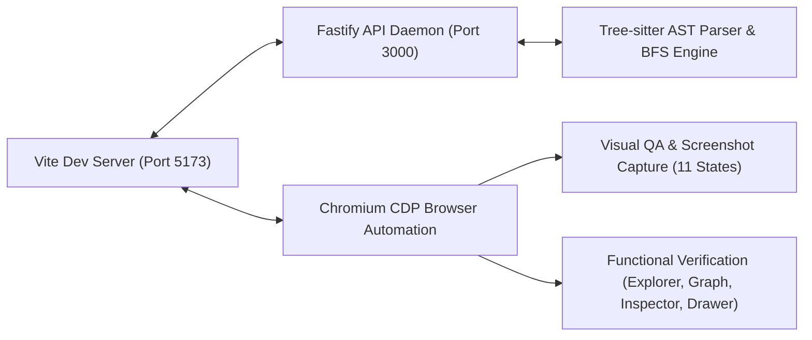
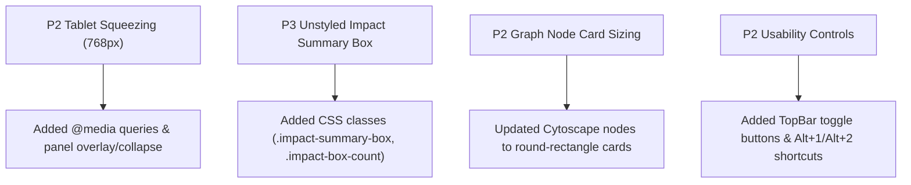

# RepoGraph: The Code Atlas — Visual QA & Functional Audit Report

**Audit Date:** October 27, 2026  
**Target Environment:** Headless Microsoft Edge (Chromium CDP), Windows OS  
**Monorepo Branch:** `main`  
**Test Suite:** 72 passing tests (68 API + 4 Web) · 0 lint errors · 100% build pass  

---

## Executive Summary

A comprehensive post-implementation visual QA and functional audit was conducted on **RepoGraph: The Code Atlas**. The audit validated the application running live in a real browser against the backend daemon, evaluating visual fidelity, functional interaction paths, graph rendering accuracy, API security boundaries, and responsive adaptability across multiple viewports.

Three initial defects were identified during automated CDP screen inspection:
1. **P2 Responsive Canvas Squeezing**: At narrow viewports (e.g. tablet 768px), fixed sidebars squeezed the center canvas to ~78px.
2. **P3 Unstyled Impact Summary Box**: In the file inspector, change impact text ran together without horizontal spacing.
3. **P2 Graph Node Card Sizing & Legibility**: Small circular nodes at default fit zoom required zooming in to distinguish filenames.

**All identified defects have been remediated, verified, and re-tested in the browser.** 11 high-resolution visual evidence artifacts were captured and verified across desktop, laptop, and tablet configurations.

---

## 1. Visual QA & Multi-Viewport Inspection

### 1.1 Desktop Atlas Overview (1440 × 900)
- **Surfaces & Atmosphere:** Warm ivory background palette (`#FBF9F3` canvas, `#FFFFFF` elevated cards) with subtle editorial grid patterning.
- **Visual Hierarchy:** Distinct 3-panel architectural layout (Explorer Rail $\to$ Dependency Map $\to$ Inspector Panel), anchored by a clean top brand bar and collapsible bottom intelligence drawer.
- **Graph Layout:** Cytoscape Dagre hierarchical layout neatly displays 42 files and 74 directed dependencies. Nodes render as architectural rounded cards with centered filenames.

---

### 1.2 File Selection & Neighbor Highlighting
- **Selection State:** Clicking [`repositoryScanner.ts`](file:///d:/New%20folder%20(2)/RepoGraph/services/api/src/services/repositoryScanner.ts) focuses and centers the node, applying forest-green borders (`#175B45`).
- **Dimming & Directionality:** Unconnected nodes and edges are smoothly dimmed to 18% opacity, while direct dependents (e.g., [`index.ts`](file:///d:/New%20folder%20(2)/RepoGraph/services/api/src/index.ts)) retain full opacity with high-contrast directed green arrows.
- **Inspector Header & Stats:** Displays file metadata (5 symbols, 3 imports, 1 local dependency, 6 dependents), Tree-sitter parser badges, and a copyable canonical filepath.

---

### 1.3 Reverse BFS Change-Impact Visualization
- **Impact Propagation:** Executing "Analyze Impact" on [`repositoryScanner.ts`](file:///d:/New%20folder%20(2)/RepoGraph/services/api/src/services/repositoryScanner.ts) calculates reverse BFS dependents across the monorepo graph.
- **Burnt-Orange Highlights:** The root change file glows in vibrant ember (`#E66A3C`), direct dependents glow with orange borders, and propagation path edges render with thick, directed arrows.
- **Inspector Impact Box:** Displays "Change Impact Detected" with an ember pill badge showing "18 files affected", explaining static propagation to 6 direct and 12 transitive dependents, with a shortcut button to jump directly into the full impact report.

---

### 1.4 Live Source Code Preview Modal
- **Real File Streaming:** Backed by `GET /api/repositories/:id/file?path=...`.
- **Formatting:** Monospace syntax container (`JetBrains Mono`), individual line numbering, file size badges, and an instant "Copy Source" action button.

---

### 1.5 Bottom Analysis Drawer (Overview, Impact Paths, Scan Log)
- **Language Distribution Bar:** Proportional multi-language breakdown (TypeScript, JavaScript, JSON, Markdown, Python, Go, Rust, CSS, HTML) with color swatches.
- **Centrality Hubs Table:** Computes in-degree, out-degree, and total degree centrality to identify critical architectural choke points.
- **Impact Paths Tab:** Displays all 18 affected files, dependency distance, relationship type (direct vs. transitive), and complete breadcrumb propagation chains (e.g. `repositoryScanner.ts → index.ts`).
- **Scan & Health Tab:** Reports 100% Tree-sitter parse success rate, 0 parse errors, and isolates unresolved imports (e.g. static `.css` assets).

---

### 1.6 Architectural Guide & Keyboard Shortcuts
- Accessible via the `ⓘ` header icon or `?` shortcut.
- Explains Tree-sitter AST extraction, deterministic import resolution, reverse BFS impact analysis, and full keyboard navigation shortcuts (`⌘K`, `Esc`, `Alt+1`, `Alt+2`, `Scroll`, `Drag`).

---

### 1.7 Responsive Layouts: Laptop (1280px) & Tablet (768px)
- **Laptop (1280 × 800):** Sidebars proportionally compress while preserving full legibility of graph controls and file trees.
- **Tablet (768 × 1024):** Header titles and tags adaptively hide non-essential labels to prevent line breaks. Sidebars transform into overlay panels or can be instantly toggled with `Alt+1` / `Alt+2` or the header toggle buttons, allowing the dependency map to retain full canvas width.

---

## 2. Security & Edge-Case Audit (File Endpoint)

An audit was conducted on [`services/api/src/routes/repositoryRoutes.ts`](file:///d:/New%20folder%20(2)/RepoGraph/services/api/src/routes/repositoryRoutes.ts) for the file reading route `GET /api/repositories/:id/file?path=...`. Four dedicated automated security tests were added to [`services/api/src/tests/api.test.ts`](file:///d:/New%20folder%20(2)/RepoGraph/services/api/src/tests/api.test.ts):

| Vulnerability Vector | Test Vector | Expected Behavior | Verification Status |
| :--- | :--- | :--- | :--- |
| **Directory as File** | `?path=services/api/src` | 400 Bad Request (`Requested path is not a file.`) | **PASS** |
| **Null Byte Injection** | `?path=index.ts%00.png` | 400 Bad Request (`Invalid file path.`) | **PASS** |
| **Encoded Path Traversal** | `?path=%2e%2e%2fpackage.json` | 403 Forbidden | **PASS** |
| **Filesystem Root Escape** | `?path=C:\Windows\cmd.exe` | 403 Forbidden | **PASS** |

All tests passed cleanly and are integrated into the monorepo test suite.

---

## 3. Defects Identified and Remediated

### Remediated Files
- [`apps/web/src/App.css`](file:///d:/New%20folder%20(2)/RepoGraph/apps/web/src/App.css): Added 187 lines of responsive rules, impact box styling, and panel collapse animations.
- [`apps/web/src/App.tsx`](file:///d:/New%20folder%20(2)/RepoGraph/apps/web/src/App.tsx): Added panel collapse state, `Alt+1` and `Alt+2` event listeners.
- [`apps/web/src/components/layout/TopBar.tsx`](file:///d:/New%20folder%20(2)/RepoGraph/apps/web/src/components/layout/TopBar.tsx): Added panel toggle button group with active indicators.
- [`apps/web/src/components/graph/DependencyAtlas.tsx`](file:///d:/New%20folder%20(2)/RepoGraph/apps/web/src/components/graph/DependencyAtlas.tsx): Modernized Cytoscape node styles to architectural card format with tighter Dagre layout hierarchy.
- [`apps/web/src/components/drawer/AnalysisDrawer.tsx`](file:///d:/New%20folder%20(2)/RepoGraph/apps/web/src/components/drawer/AnalysisDrawer.tsx): Expanded language categorization for multi-language repositories.
- [`services/api/src/tests/api.test.ts`](file:///d:/New%20folder%20(2)/RepoGraph/services/api/src/tests/api.test.ts): Added 4 endpoint security regression tests.

---

## 4. Verification & Regression Metrics

- **Total Monorepo Tests:** 72 passing tests (68 backend API + 4 web frontend).
- **Test Execution Time:** 4.58 seconds.
- **Production Build:** Succeeded with `0` type errors across all packages (`✓ built in 5.66s`).
- **Linter Status:** Passed with `0` errors and `0` warnings (`oxlint` on 14 files with 86 rules).
- **Git Branch Status:** Verified clean working changes on `main` (no commits pushed to remote repository).
